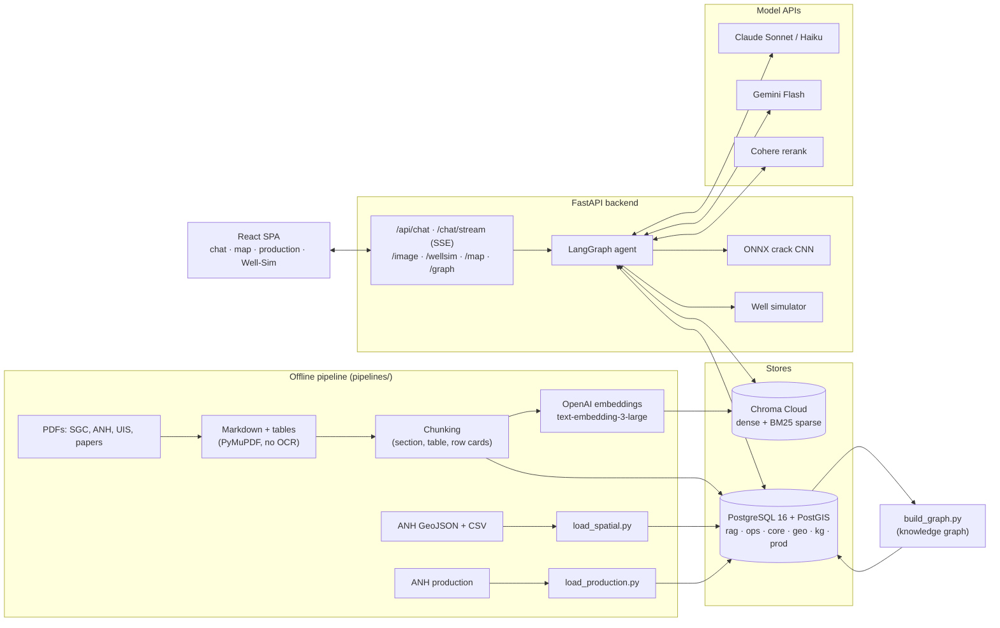
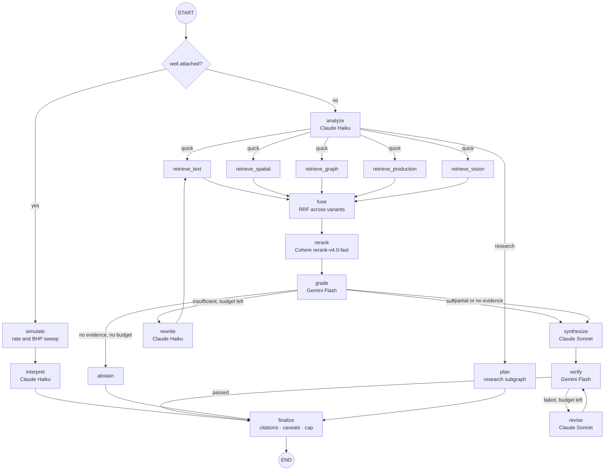
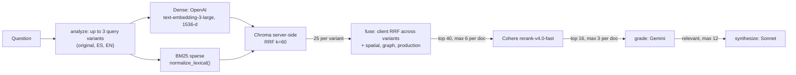
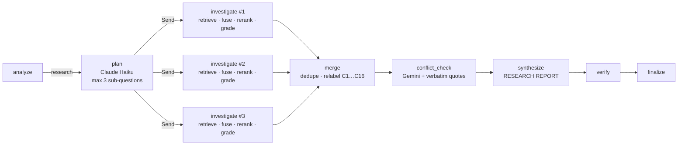
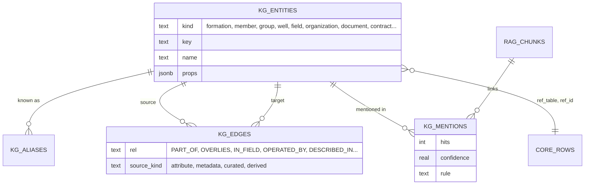
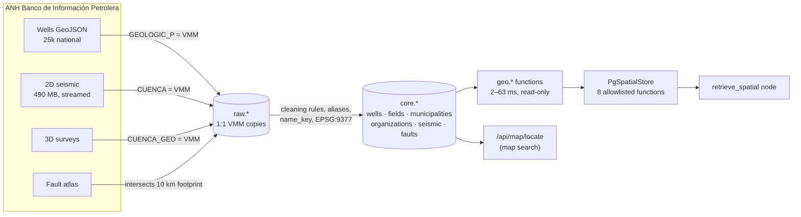
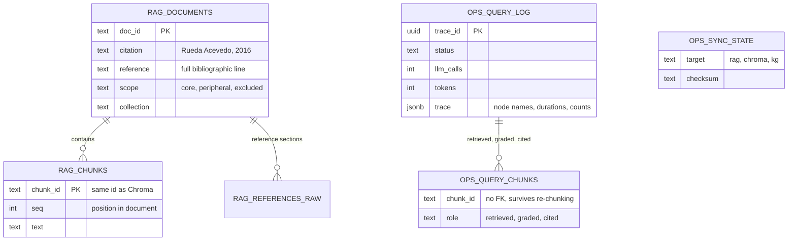
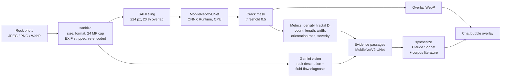
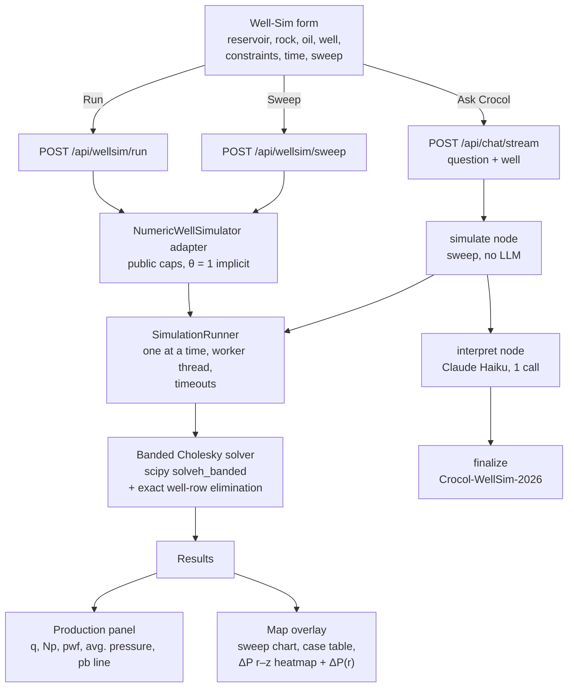
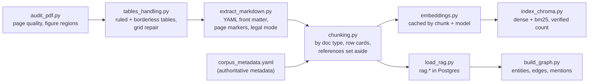

# Crocol: a knowledge-graph-augmented agentic RAG for the Middle Magdalena Valley basin (Colombia)

**Crocol** is a geologist crocodile, and an AI research agent that answers questions about the **Valle Medio del Magdalena (VMM)** petroleum basin in Colombia. It combines four kinds of evidence in one cited answer:
- a corpus of geological literature;
- the ANH well, seismic and fault inventory in PostGIS;
- a knowledge graph of formations, wells, fields and documents;
- the official monthly oil and gas production by field.

Crocol can also measure the cracks in a rock photo with a custom CNN, and run a numerical oil-well simulator and explain its results.

Architecturally, Crocol is **hybrid, knowledge-graph-augmented agentic RAG**: dense + BM25 + knowledge graph + PostGIS + production SQL retrieval, with corrective and self-verification loops. It is a single-page app (React + FastAPI) on a **LangGraph state machine** with:
- hybrid dense and **BM25** retrieval, fused with **Reciprocal Rank Fusion**;
- a curated **knowledge graph** and allowlisted **PostGIS** and production SQL functions as further retrieval channels;
- **Cohere reranking**;
- LLM evidence grading with a corrective retry (rewrite → retrieve again);
- claim verification by a model from a different family, with a revise loop;
- citations rendered from metadata, never from model text.

See [Architecture: what kind of agent Crocol is](#architecture-what-kind-of-agent-crocol-is) for the precise classification.

---

Crocol is an agentic, Advanced RAG system built to answer technical questions about the petroleum geology of Colombia’s Middle Magdalena Valley (VMM) basin. The real engineering problem it solves is not geology itself: it is reliable retrieval and reasoning over a large, heterogeneous, unstructured corpus — 111 sources spanning geological theses, government technical reports, exploration contracts, and regulatory text — where the answer to a single question often requires combining a narrative passage, a data table, a SQL aggregation over well records, and a spatial relationship between a field and a municipality. A junior geologist, analyst, or researcher working with the VMM basin today has no single tool that lets them ask a natural-language question and get a verified, cited answer instead of manually searching dozens of PDFs.

Crocol’s scope is deliberately narrow: one basin, three core tools, and a tiered corpus (core basin literature, peripheral regulatory and contract documents, excluded duplicates and unverified AI-generated reports). This is a design choice, not a limitation — a bounded domain allows for a real evaluation suite (gold questions, citation checks, hallucination traps) instead of shallow coverage across all of Colombia’s geology or unrelated fields such as mining or biodiversity. The architecture combines hybrid dense and BM25 retrieval with server-side fusion, a knowledge graph over wells, fields, formations, and municipalities for multi-hop questions, and a parameterized PostGIS/SQL layer for tabular and spatial queries that plain document retrieval cannot answer (rankings, aggregations, “what fields lie within this municipality”).

The graph and SQL nodes exist because a text-only RAG system fails predictably on this kind of corpus: it cannot rank or aggregate numeric data, it loses table structure during chunking, and it cannot connect an entity mentioned in one document (a mineral host, a case study) to a mechanism described in another. A dedicated LangGraph agent routes each question to the right retrieval strategy, verifies claims and citations against the retrieved sources before responding, and explicitly abstains rather than fabricating data when the corpus does not support an answer — behavior confirmed through manual evaluation against the indexed documents. Crocol is, above all, a demonstration of applied Advanced RAG engineering: hybrid search, graph reasoning, structured-data tools, and hallucination control, built on a real and intentionally constrained domain.

I wanted to build up a research agent graph that understand a domain subject like Geology of Colombia on Hydrocarbon Explroation,  apply its hybrid corpus to  provide reliable truthworth scientific answers cited papers and books passages and authors from his corpus and add value to the most important geologic basin in Colombia, I choose this domain becuase it combine  non-structured data such a  pdf papers, research theses, gouverment agencies handbooks and tech manuals with  geo-spatial data such a oil-fields and wells locations,  production history and sismic polygons, hence it  makes it real use of a knowledge-graph-augmented agentic RAG architecture, with models from three providers (Claude, Gemini and the Cohere reranker) working as specialists on their own tasks.
  
## Contents

1. [The problem Crocol solves](#the-problem-crocol-solves)
2. [Knowledge sources](#knowledge-sources)
3. [System architecture](#system-architecture)
4. [Architecture: what kind of agent Crocol is](#architecture-what-kind-of-agent-crocol-is)
5. [The agent graph](#the-agent-graph)
6. [Advanced RAG: hybrid retrieval, BM25, RRF and Cohere rerank](#advanced-rag-hybrid-retrieval-bm25-rrf-and-cohere-rerank)
7. [Research mode: orchestrator–workers fan-out](#research-mode-orchestratorworkers-fan-out)
8. [Knowledge graph: KG-augmented retrieval](#knowledge-graph-kg-augmented-retrieval)
9. [Spatial layer (PostGIS)](#spatial-layer-postgis)
10. [Document registry and app logs](#document-registry-and-app-logs)
11. [Production layer](#production-layer)
12. [Vision layer: crack segmentation](#vision-layer-crack-segmentation)
13. [Well simulator layer](#well-simulator-layer)
14. [Offline document pipeline](#offline-document-pipeline)
15. [Frontend](#frontend)
16. [Privacy, safety and cost guards](#privacy-safety-and-cost-guards)
17. [Tech stack](#tech-stack)
18. [Getting started](#getting-started)
19. [Repository layout](#repository-layout)
20. [Limitations](#limitations)

---

## The problem Crocol solves

Knowledge about the VMM is scattered and hard to query:
- **Geology** lives in hundreds of pages of PDFs: SGC special publications, ANH bidding-round reports, university theses and journal papers, mostly in Spanish, with key numbers buried in tables.
- **Operational facts** (which wells are in which field, who operates them, which seismic surveys cover an area) live in large ANH GeoJSON exports that no one can read by eye.
- **Production** lives in monthly ANH spreadsheets.
- **Relationships** (this well belongs to that field, which this thesis describes, which sits on the La Luna Formation) exist only in an expert's head.

Crocol aims to be a **live, queryable knowledge base of the VMM basin and its producing fields**. A student or geoscientist can ask, in Spanish or English:

- *"¿Cuál es el ambiente deposicional de la Formación La Luna ?"* (literature + knowledge graph)
- *"¿Qué campos tienen pozos en Puerto Wilches y quién los opera?"* (PostGIS + knowledge graph)
- *"¿Cómo ha evolucionado la producción de crudo de Casabe?"* (ANH production, with a chart and trend)
- *"Compare the source-rock potential of La Luna and Simití"* (research mode, with conflicting values flagged)
- a rock photo and *"¿Qué tan fracturada está esta roca?"* (crack CNN + visual interpretation)
- a well description and *"¿A qué tasa debo operar este pozo?"* (numerical well simulator)

Every answer cites its sources, and the agent says when the evidence is partial or when sources disagree.

## Knowledge sources

All the evidence comes from official or academic sources:

| Source | What Crocol uses |
|---|---|
| **ANH** (Agencia Nacional de Hidrocarburos) | *Banco de Información Petrolera*: 10,705 VMM wells, 2,262 2D seismic lines, 57 3D surveys, faults; fiscalized oil and gas production by field (2025–2026); the 2021 bidding round; the 2022 E&P contracts and Acuerdo 02 de 2017; reserves reports |
| **SGC** (Servicio Geológico Colombiano) | Special publications on VMM stratigraphy and petroleum systems; 2026 reports on the Cretaceous source rocks; the live *Mapa Geológico de Colombia 2023* on the map |
| **UIS** (Universidad Industrial de Santander) and other universities | Theses on VMM geology, petrophysics, EOR and the Barrancabermeja refinery |
| **Peer-reviewed literature** | Journal papers and book chapters on Middle Magdalena geology |

The corpus has **111 documents** (74 core, 32 peripheral, 5 excluded duplicates) and **11,420 chunks**. Metadata (authors, year, institution, document type, formations) is curated by hand in `corpus_metadata.yaml`, and citations are rendered from it, for example "(Rueda Acevedo, 2016, p. 41)".

Contracts and regulations are kept in separate collections, and a few unverified AI-generated field reports are indexed as `peripheral`. Default searches never return them; when they are used, the answer says so.

---

## System architecture



The code follows a ports-and-adapters layout:
- `domains/` holds pure standard-library logic (citations, fusion, linking, trends).
- `application/` holds the agent graph, the tools and the **ports** (protocols).
- `infrastructure/` holds the adapters (Chroma, psycopg, Claude, Gemini, Cohere, ONNX, the simulator). It is the only layer that imports SDKs or numerical libraries.
- `src/bootstrap.py` is the composition root.

Tests replace every port with a fake, so the whole agent graph runs offline.

---

## Architecture: what kind of agent Crocol is

**Crocol is hybrid, knowledge-graph-augmented agentic RAG: dense + BM25 + KG + PostGIS + production SQL retrieval, with corrective and self-verification loops.** This section explains why each part of that sentence fits and why the trendier labels ("multi-agent", "GraphRAG") don't.

### Control plane: a deterministic state machine, not a supervisor agent

There is no master or orchestrator LLM. The agent is one LangGraph `StateGraph` whose **edges are pure Python functions** (`application/agent/routing.py`). They read typed state (`AgentState`) and the remaining LLM-call budget, and return the next node. LLMs never choose the next node and never call tools through function calling.

| Concern | Decided by | Mechanism |
|---|---|---|
| Next node | `routing.py` (code) | Conditional edges over state: `grade.sufficient`, `attempts`, `verified`, `calls_left(state)` |
| Which tools are relevant | `analyze` (Claude Haiku), **indirectly** | A structured output (`intents`, `places`, `entities`, `well_query`, `query_variants`, `mode`) validated by Pydantic. Tools read it as data. |
| Tool execution | Nodes (code) | All five retrievers start in parallel; each one returns `skipped` when the analyzer gave it no input |
| Writing and judging | Specialist LLM roles | `config/roles.py` maps roles to models: analyze, plan, rewrite and interpret on Haiku; synthesize and revise on Sonnet; grade, verify, conflict and vision on Gemini Flash |

The closest thing to an orchestrator is `analyze`, an **LLM router and planner whose decisions are data**: code acts on them. This is the "workflow with LLM steps" end of the agent spectrum rather than the "autonomous tool-calling loop" end. The choice is deliberate, and it is what makes the system:
- **Cost-bounded.** Every path has a known ceiling of LLM calls (4 quick, 5 with an image, 8 research, 1 simulation), enforced at each branch by `calls_left`. No model can decide to loop again.
- **Testable offline.** `tests/fakes.py` replaces every port, so the full graph runs in the test suite with no network (400+ tests in about 20 s).
- **Auditable.** The set of possible paths is small and known. Each run persists a node-by-node trace (`ops.query_log`) and emits structured logs: one line per node, per LLM call (tokens, ms) and per question.
- **Robust.** `bind()` wraps every node with a timeout and turns any exception into a `partial` answer instead of a crash. Optional nodes (rerank, verify, conflict_check) can fail without degrading the answer status.

### Why "agentic RAG"

Classic RAG is a fixed retrieve → generate pipeline. Crocol adds the control behaviour that defines agentic RAG:
- **Query planning:** the analyzer writes up to 3 query variants (original, Spanish, English), picks the BM25 query language, and chooses quick or research mode.
- **Adaptive routing:** retrieval channels are selected by intent; a question with an attached well bypasses retrieval entirely (`simulate → interpret → finalize`); a question with no relevant evidence is routed to a general-knowledge answer or an abstention.
- **Corrective RAG (CRAG) loop:** `grade` judges whether the evidence is sufficient. If not, `rewrite` changes the search strategy (translation, scope, exact vs conceptual) and the retrievers run again, up to `MAX_ATTEMPTS = 2`.
- **Self-verification loop:** `verify` splits the draft into claims and checks each one against the evidence with a model from a different family (Gemini checks Claude). A deterministic pass also flags numbers absent from the evidence. `revise` rewrites or removes failing claims, then verify runs again.
- **Budget gating:** both loops only fire when the remaining call budget can pay for them (`rewrite` needs 4 calls left, `revise` 2). At the current budgets, quick and image questions take the single pass, and revise is reachable in research mode when the plan has at most 2 sub-questions. Raising `LLM_CALL_BUDGET` turns the loops on without code changes; the routing is covered by offline tests.

### Why "hybrid" and "KG-augmented"

Five retrieval channels feed one evidence funnel (fuse → rerank → grade → synthesize):

| Channel | Store | Retrieval | Answers |
|---|---|---|---|
| Text | Chroma Cloud | Dense (`text-embedding-3-large`, 1536-d) + BM25 sparse, RRF k = 60 | Narrative and tabular literature, cross-language |
| Knowledge graph | PostgreSQL `kg.*` | `kg.resolve` → `kg.evidence_chunks` + `kg.facts` / `kg.entity_documents`, `kg.path` between two entities | Entity facts, stratigraphic relations, chunks linked to an entity |
| Spatial | PostGIS `geo.*` | 11 allowlisted SQL functions (counts, group-by, lists, distances, near-fault) | Well and field inventory, rankings, aggregations, geometry |
| Production | PostgreSQL `prod.*` | Field or contract resolution, monthly series, Python trend classification | Fiscalized oil and gas production and its trend |
| Vision | ONNX CNN + Gemini | Crack segmentation and metrics, plus a visual description | Rock-photo fracture analysis |

Structured channels emit **synthetic passages** (database rows, graph facts, crack metrics) that skip the reranker and lead the evidence, so a SQL aggregate and a thesis paragraph are cited side by side in one answer. No model writes SQL: every query is a fixed, parameterized, allowlisted function.

### Why not "GraphRAG" in the Microsoft sense

"GraphRAG" (Edge et al., Microsoft Research, 2024) names a specific pipeline. An LLM extracts entities and relations from every chunk, community detection (Leiden) partitions the graph hierarchically, an LLM writes a summary of each community, and "global" questions are answered by map-reduce over those summaries. Crocol does none of that:

| | Microsoft GraphRAG | Crocol |
|---|---|---|
| Graph construction | LLM extraction over the whole corpus | Curated YAML (stratigraphy) + ANH database attributes + document metadata |
| Entity linking | LLM | Deterministic Aho-Corasick matcher with geological cue-word rules |
| Graph size and cost | Large; indexing costs scale with corpus tokens | 11,978 entities, 45,480 edges; rebuilt in ~5 s with no LLM call |
| Communities and summaries | Leiden hierarchy, LLM community reports | None |
| Query use | Global (community map-reduce) and local search | Local only: entity resolution, facts, linked chunks, ≤ 3-hop paths |
| Spatial relations | Stored edges, if any | Computed by PostGIS at query time, never materialized |
| Role in the answer | Primary index | One retrieval channel among five, fused and reranked with the rest |

The accurate term is **knowledge-graph-augmented retrieval**: a small, precise, referencing graph that grounds entities and relations and adds no LLM call to a question.

### Why not "multi-agent"

Multi-agent usually means several autonomous LLM agents, each with its own loop and tools, coordinated by a supervisor or by message passing. Crocol's LLM roles are **specialists inside fixed nodes**: one structured call each, with no private loop or tool choice. The one place with an orchestrator–workers shape is research mode (`plan` → `Send` × ≤ 3 → `investigate` → `merge`). Even there, the workers run a fixed retrieve → fuse → rerank → grade pipeline. It is a map-reduce fan-out under a single state machine, not a society of agents.

### Planned extension

The v2 **SQL sub-agent** is the one place where a bounded agentic step pays off. It would be reached through `well_query.op = "custom"`, and a Sonnet worker would write read-only SQL over curated views for questions the allowlisted functions cannot express. It would run under its own guard rails: a `SELECT`-only role, a function allowlist, an `EXPLAIN` cost guard, `LIMIT` and attack tests. It would be a worker inside the state machine, not a supervisor over it.

---

## The agent graph

Crocol's agent is a **LangGraph state graph of specialised nodes**. Each node has one job; the LLM nodes make one structured call each, to the model chosen for that role, and the edges between nodes are plain Python routing functions. Every node is wrapped by `bind()`, which adds a timeout, timing and a trace event, and turns errors into a partial answer instead of a crash. The SSE stream shows each step live in the chat.



| Node | Model | Job |
|---|---|---|
| `analyze` | Claude Haiku | Detects language and intents (conceptual, spatial, production…), writes up to 3 query variants (original plus Spanish/English), extracts places and entities, chooses quick or research mode |
| `retrieve_text` | (none) | Hybrid dense + BM25 search in Chroma, once per query variant, concurrently |
| `retrieve_spatial` | (none) | Calls allowlisted `geo.*` PostGIS functions for the places in the question |
| `retrieve_graph` | (none) | Resolves entities in the knowledge graph; returns linked chunks and a facts passage |
| `retrieve_production` | (none) | ANH monthly production of the named fields, with a computed trend |
| `retrieve_vision` | ONNX CNN + Gemini | Crack segmentation and measurements, plus a visual description of the rock |
| `fuse` | (none) | Client-side RRF across variants and channels, dedupe, per-document cap |
| `rerank` | Cohere | Cross-encoder rerank of the top 40; keeps 16, labelled C1…C16 |
| `grade` | Gemini Flash | Keeps the relevant passages and decides whether the evidence is sufficient |
| `rewrite` | Claude Haiku | A new search strategy (translation, wider scope, exact vs conceptual) |
| `synthesize` | Claude Sonnet | A scientific answer from the labelled evidence only |
| `verify` | Gemini Flash | Splits the answer into claims and checks each one against the evidence (a different model family judges) |
| `revise` | Claude Sonnet | Fixes or removes failing claims |
| `finalize` | (none) | Renders citations from `rag.documents`, caps citations per paragraph, adds caveats and references |

**Budgets.** Quick mode makes **4 LLM calls**: analyze, grade, synthesize, verify. Research mode makes **8**, an image question 5, and a simulation question 1. The routing functions in `routing.py` check the budget at every branch. When it runs out, the agent finalizes with the best evidence it has and marks the answer *partial*, instead of failing.

**Answer policy:**
- *Partial evidence:* when relevant passages exist but don't cover everything, the agent answers and states what the corpus does not cover.
- *General knowledge:* the writer may add well-known facts in paragraphs labelled `[KG]`. These are rendered as "(Crocol-KG-2026)" and never checked against the corpus.
- *Citations:* at most one citation per paragraph, at its end; two only when a paragraph combines two sources. `finalize` enforces this in code.
- *Suggested further work:* every answer ends with 2–4 concrete next steps for a researcher.

---

## Advanced RAG: hybrid retrieval, BM25, RRF and Cohere rerank



- **Chunking by document type:**
  - articles and theses: section-aware chunks of about 750 tokens (900 max), with 100 tokens of overlap;
  - contracts and regulations: one clause or article per chunk;
  - glossaries: one term per chunk;
  - presentations: one page per chunk.
  
  Tables become their own chunks, and numeric tables also produce **row cards**, so that a single value (a TOC, a porosity) can be retrieved on its own.
- **Dense channel:** OpenAI `text-embedding-3-large` at 1,536 dimensions, cosine. It won an A/B test against Gemini embeddings (MRR@10 0.90 against 0.88; cross-language MRR 1.00 against 0.87).
- **BM25 channel:** Chroma's BM25 sparse index runs on `lexical_text`. Documents and queries go through the same `normalize_lexical()`, which folds accents, removes Spanish and English stopwords, and joins codes into single tokens (`VMM 53` → `vmm_53`, `Cagui-1` → `cagui_1`). This makes exact lookups of well names, contract areas and article numbers reliable; BM25 scored hit@5 1.00 on exact-term probes. SPLADE was tested and dropped: it is English-only and lowered the fused MRR.
- **Fusion:** dense and BM25 are fused server-side with RRF (k = 60, equal weights, re-tuned on the full index). Then `fuse` merges the query variants and the other channels with a client-side RRF.
- **Cohere rerank:** `rerank-v4.0-fast` reorders the top 40 with a 6 s timeout. If Cohere is slow or down, the fused order is kept. Synthetic passages (database results, graph facts, crack measurements) skip the reranker and go first; unverified AI reports go last. On a 30-question gold set it raised **MRR from 0.46 to 0.62**, and the right chunk ranked first went from 11 to 18 questions.
- **Grading, then verification:** Gemini grades the evidence, Claude writes, and Gemini checks every claim. A deterministic pass also flags any number in the answer that doesn't appear in the evidence. Unsupported claims are revised or removed before the user sees them.
- **Conflict detection:** in research mode, Gemini extracts property values (TOC, Tmax, Ro, thickness, porosity), and Python keeps only quotes found verbatim in the chunk. Values from different documents that don't overlap become a "Where sources disagree" section; values in different units are marked as not comparable.

---

## Research mode: orchestrator–workers fan-out

For broad or comparative questions, `analyze` switches to **research mode**, a map-reduce over sub-questions:
1. A planner splits the question into up to 3 self-contained sub-questions. This avoids query dilution: an embedding of a multi-topic question lands near the corpus centroid and ranks each topic's best chunk poorly.
2. Each one is investigated **in parallel** by a worker branch, through LangGraph `Send`. A worker runs a fixed retrieve → fuse → rerank → grade pipeline, with no retry.
3. The results are merged, checked for conflicts, and written up as a structured report.



A research answer runs about 900–1,500 words, with a section per sub-question, a conclusion, and a "Where sources disagree" section when values conflict. The budget is 8 LLM calls and 180 s.

---

## Knowledge graph: KG-augmented retrieval

This is a curated, referencing knowledge graph used as a retrieval channel, not Microsoft-style GraphRAG (see [Architecture](#why-not-graphrag-in-the-microsoft-sense)). Vector search misses multi-hop and relational questions:
- *"Which operator runs the field where well Infantas-1613 is, and which documents describe it?"*
- *"Which members does La Luna have?"*
- *"What lies above Simití?"*

Crocol's knowledge graph answers them **without an extra LLM call**.



- **A small graph that references, not copies.** Entities point at their `core` rows (wells, fields, municipalities) and their `rag` rows (documents). Spatial relations such as *near* and *inside* are computed by PostGIS at query time, not stored as edges.
- **Size:** 11,978 entities (all 10,705 VMM wells plus 31 hand-curated stratigraphic units), 45,480 edges, and 9,629 chunk mentions in 3,647 chunks.
- **Curated stratigraphy:** `kg/formations.yaml` lists the units, members and groups, which unit overlies which, and their ages.
- **Relations** include `PART_OF` (member of a formation or group), `OVERLIES`, `IN_FIELD`, `OPERATED_BY`, `IN_CONTRACT`, `GOVERNED_BY`, `DESCRIBED_IN` and `AUTHORED_BY`.
- **Deterministic entity linking:** an Aho-Corasick matcher with geological rules decides when a name in a chunk is really that entity:
  - cue words ("Formación", "Grupo") decide the kind;
  - well names need their number ("Casabe-1352");
  - field names that are common Spanish words (FORTUNA, LILIA) need a cue or document evidence;
  - citations ("et al.", a year) block place names;
  - the longest match wins.
- **Graph functions** in SQL (2–80 ms each): `kg.resolve`, `kg.facts`, `kg.neighbors` (≤ 2 hops), `kg.path` (≤ 3 hops), `kg.entity_documents`, `kg.evidence_chunks`.
- **Agent use:** `retrieve_graph` resolves the entities that `analyze` found. It returns their linked chunks plus one **facts passage** per entity (with the `kg.path` between the first two entities when there are several), cited "Crocol-KG-2026", which goes into the same fuse → rerank → grade pipeline as the text evidence.
- **Entity cards:** the frontend shows graph cards for a formation or a located place, through `GET /api/graph/entity`.

---

## Spatial layer (PostGIS)

The ANH inventory is loaded into PostGIS, **filtered to the VMM before loading**. Raw copies are kept for provenance, and a cleaned `core` model serves the agent through fixed SQL functions.



- **Counts:** 10,705 wells, 2,262 2D lines (about 29,100 km), 57 3D surveys, 595 faults, 192 fields, 62 municipalities and 206 organizations. The footprint covers 51,164 km².
- **Cleaning:**
  - accent-insensitive name keys (`YONDÓ (CASABE)` → `YONDOCASABE`) on both the data and the user's input;
  - placeholder dates (1900-01-01) set to null, with the year taken from the survey name instead;
  - lengths and areas recomputed on the geography;
  - MAGNA-SIRGAS CTM12 (EPSG:9377), registered by the migration because the PostGIS image lacks it.
- **Safety:** the agent never writes SQL. It calls 8 allowlisted functions with typed, parameterized arguments over a read-only pool with a 5 s statement timeout.
- Spatial evidence is cited "ANH-Informacion-Petrolera-2026", and its count and total lines are copied exactly.

## Document registry and app logs

Postgres is the authoritative registry for everything except the vectors. Citations and reference lists come from here, never from model text. Traces are **app logs, not chat logs**: they never store the question or the answer.



The loader checks that Postgres and Chroma hold the same 11,420 chunks, and records sync checksums. Migrations are plain numbered SQL files, applied by `db/migrate.py`.

---

## Production layer

`core.oil_production` and `core.gas_production` hold the ANH **fiscalized production** per field, contract, municipality and month (2025-01 to 2026-08, all of Colombia), in ANH's own units: BPDC for oil and MPCPDC for gas.
- **Field resolution:** `prod.resolve_field` resolves a field or a contract that groups fields; for example "La Cira-Infantas" is LA CIRA + INFANTAS.
- **Trend:** Python fits a least-squares trend to each series. A fitted change within ±5 % is *stable*, residual scatter above 20 % is *variable*, and the rest is *increasing* or *decreasing*.
- **Display:** the series and trend badges appear in the Production panel next to the answer, cited "ANH-Produccion-Fiscalizada-2026".

---

## Vision layer: crack segmentation

Users can attach a photo of a rock or an outcrop. Crocol runs the owner's own **MobileNetV2-UNet** crack-segmentation CNN (6.63 M parameters, trained on GeoCrack; IoU 0.63 and F1 0.77 on its test set) locally on CPU with ONNX Runtime.



- **Measurements:** crack density, fractal dimension (box counting), crack count, length, width, and a rose diagram of orientations. They are in pixels and image-frame angles, since a photo has no scale or compass. The severity class is a heuristic, not an engineering standard.
- **Answer:** Sonnet combines the measurements and the visual interpretation with corpus literature on fractured reservoirs in the VMM.
- **Speed:** about 3 s per photo, using about 0.5 GB of memory.

---

## Well simulator layer

A **numerical oil-well simulator** (the owner's code) models single-phase undersaturated oil flow toward a well in a **radial r–z cylinder** with a logarithmic grid. It is an academic screening tool: no water, no free gas, no relative-permeability curves.



- **Solver:** the cell block is symmetric positive-definite and banded (offsets 0, 1 and Nz), so each implicit time step uses a **banded Cholesky** solve, and the well's bordering row and column are eliminated exactly. Compared with the original dense solver, it gives the same results to about 1e-9 psi and runs **40× faster** on a default sweep (23 s → 0.5 s) with a fifth of the memory. It runs single-threaded on purpose: for matrices this small, BLAS threads were slower.
- **Sweep:** it tries a grid of rate and bottomhole-pressure controls and reports:
  - the **recommended rate**, the lowest rate whose recovery is within tolerance of the best;
  - the **best discounted rate**, which gains from the time value of money;
  - the **binding constraints**: the bubble-point floor, minimum BHP, maximum drawdown, facility limit or economic limit.
- **Agent path:** when a chat question carries a well, the agent **skips the whole research chain** and goes straight from `simulate` to a single Haiku call that interprets the sweep. That call:
  - never recomputes numbers and answers in the user's language;
  - gives the recommended operating rate and minimum flowing BHP;
  - advises keeping the pressure above the bubble point;
  - restates the single-phase assumptions.
- **Public limits:**
  - grid ≤ 50 × 20 cells and ≤ 365 time steps;
  - ≤ 12 rate and ≤ 10 BHP cases per sweep;
  - 10 runs per minute and 20 sweeps per day per IP;
  - the time scheme is fixed at fully implicit, with closed boundaries.

---

## Offline document pipeline



- Extraction is text-only with PyMuPDF; there's no OCR.
- Scanned ANH contracts use a **legal mode** that splits them by ANEXO, CAPÍTULO, clause and article.
- Theses get their authors, institution and year from their file names.
- Embeddings are cached by chunk id and content hash, so adding documents only pays for the new chunks. The full corpus cost about $0.41 to embed.

---

## Frontend

A React + TypeScript + Tailwind + Vite SPA, with five panels:
- **Stratigraphic column:** the VMM units, with formation details and "Investigate with Crocol".
- **Chat:**
  - live SSE steps show which node is working;
  - answers are rendered as Markdown;
  - citations, collapsible caveats, conflicts and crack overlays are shown;
  - the conversation is stored in the browser.
- **Geological map (MapLibre GL):**
  - the live **SGC Mapa Geológico de Colombia 2023** layer, with click-to-identify on chronostratigraphic units;
  - place search through PostGIS, with knowledge-graph entity cards.
- **Production panel (Recharts):** ANH oil and gas series with trend badges, or the well simulator's curves.
- **Well-Sim:** a header button opens the simulator form over the stratigraphy column; results appear over the map and in the Production panel.

The interface is bilingual (Spanish and English).

---

## Privacy, safety and cost guards

- **No chat logs:**
  - questions, answers, query variants and model free text are never persisted;
  - traces keep only node names, timings, counts and chunk ids;
  - well-simulator parameters are never stored.
- **Uploaded images** are the one exception: a sanitized JPEG copy with EXIF stripped is kept for 72 h, then purged.
- **Database:** read-only pool sessions with a 5 s statement timeout and fixed, parameterized SQL only. The models never write SQL.
- **Abuse and cost limits:**
  - 1 question per minute and 12 per day per IP;
  - 30 questions and about 800k tokens per day for the whole app;
  - 2 concurrent agent runs;
  - LLM-call budgets per mode and a total timeout per question.
- **Fail soft:**
  - a slow reranker keeps the fused order;
  - a failed verifier leaves the draft with a note;
  - a timeout returns a *partial* answer, never a crash.

---

## Tech stack

| Layer | Technology |
|---|---|
| Agent | LangGraph 1.2, Pydantic structured outputs |
| LLMs | Claude Sonnet (writer), Claude Haiku (analyst, planner, simulation interpreter), Gemini Flash (grader, verifier, vision), with cross-family fallbacks |
| Retrieval | Chroma Cloud (dense + BM25 sparse, server-side RRF), OpenAI `text-embedding-3-large`, Cohere `rerank-v4.0-fast` |
| Database | PostgreSQL 16 + PostGIS 3.5 (Docker), psycopg 3 async pool |
| Vision | ONNX Runtime (CPU), MobileNetV2-UNet |
| Simulation | NumPy, SciPy (banded Cholesky) |
| API | FastAPI, SSE streaming |
| Frontend | React, TypeScript, Tailwind CSS, Vite, Recharts, MapLibre GL, zustand, Axios, react-markdown |
| Extraction | PyMuPDF, pyahocorasick |

---

## Getting started

**Requirements:**
- Python 3.12 and Node.js with npm;
- Docker;
- API keys for Anthropic, OpenAI, Google Gemini and Cohere;
- a Chroma Cloud database.

```bash
# Python environment
python3.12 -m venv magdalena
magdalena/bin/pip install -r requirements.txt
echo "$PWD/src" > magdalena/lib/python3.12/site-packages/crocol_src.pth

# Secrets: create .env (CHROMA_*, COLLECTION_NAME, POSTGRES_*, PG_DSN,
# ANTHROPIC_API_KEY, OPENAI_API_KEY, GOOGLE_API_KEY, COHERE_API_KEY), then:
magdalena/bin/python pipelines/check_env.py

# Database
docker compose up -d                              # PostGIS on 127.0.0.1:5445
magdalena/bin/python db/migrate.py
magdalena/bin/python pipelines/load_rag.py --verify-chroma
magdalena/bin/python pipelines/load_spatial.py --step all
magdalena/bin/python pipelines/load_production.py
magdalena/bin/python pipelines/build_graph.py

# API (one worker: rate limits live in memory)
magdalena/bin/uvicorn crocol.app.main:app --host 127.0.0.1 --port 8000

# Frontend (proxies /api to the API)
cd frontend && npm install && npm run dev        # http://127.0.0.1:5173
```

**Tests:** the agent graph runs offline against fakes. Postgres tests skip themselves when the container is down.

```bash
magdalena/bin/python -m pytest tests -q                       # full suite
magdalena/bin/python -m pytest tests -q -m "not integration"  # without Postgres
cd frontend && npm run lint && npm run build
```

The corpus PDFs, ANH exports and generated chunks aren't in the repository, because of their size and licensing. The pipeline scripts rebuild everything from the source files.

---

## Repository layout

```
src/
  bootstrap.py              composition root
  config/                   settings, model roles, limits, errors
  crocol/
    domains/                pure logic: citations, fusion, linking, trends
    application/
      agent/                LangGraph graph, nodes, routing, prompts
      tools/                text, spatial, graph, production, image, simulation
      ports/                protocols for every external service
      usecases/             ask a question, get a trace, get an entity
    infrastructure/         Chroma, psycopg, Claude, Gemini, Cohere,
                            ONNX vision, well simulator
    app/                    FastAPI routers, schemas, guards
pipelines/                  offline extraction, chunking, indexing, loaders
db/                         SQL migrations and functions (geo, kg, prod)
kg/                         curated formations and stop-alias lists
frontend/                   React SPA
tests/                      offline and integration tests
spikes/                     experiments, A/B reports, the simulator CLI
```

---

## Limitations

- **Short follow-up memory:** the browser sends back at most 3 signed memory records (24 h); research mode uses none. There is no server-side conversation store, by design.
- **Fixed control flow:** no LLM chooses the next step, so questions the allowlisted SQL functions cannot express (for example "the deepest well of the top 5 producing fields") are out of scope until the planned SQL sub-agent.
- **Text-only extraction:** information that exists only in images (scanned figures, maps) is not indexed.
- **Crack measurements** are in pixels and image angles, not real-world units.
- **The well simulator** is single-phase and depletion-only: a screening tool for teaching, not a reservoir-engineering design.
- **Production data** covers 2025-01 to 2026-08 only.
- **Knowledge-graph links** are rule-based; precision is still being reviewed by hand against a sample.

---

## License

The code is released under the [MIT License](LICENSE). The license covers Crocol's source code only. The corpus documents, ANH data and SGC maps it draws on belong to their owners and keep their own terms.

---

*Crocol was built as an academic portfolio project on the geology and petroleum systems of the Middle Magdalena Valley, Colombia. Data © ANH and SGC; literature © the respective authors and institutions.*
